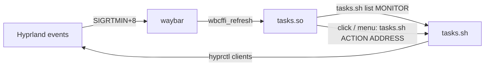

# cffi/tasks

Waybar taskbar for Hyprland with minimize support. It replaces `wlr/taskbar`, which can't show minimized windows because Hyprland has no minimized state.

Minimizing moves the window to workspace 99. The taskbar keeps showing it with a dimmed icon, and clicking the icon brings it back to the active workspace.



## Files

| File | Purpose |
|---|---|
| `tasks.c` | The waybar CFFI module. Draws one button per window and routes clicks |
| `tasks.sh` | Lists windows as JSON and runs every window action through `hyprctl` |
| `waybar_cffi_module.h` | CFFI header copied from [Waybar](https://github.com/Alexays/Waybar/tree/master/resources/custom_modules/cffi_example) |
| `Makefile` | Builds `tasks.so` |

## Build

`tasks.so` is not committed. Two user units in `waybar/.config/systemd/user` build it:

- **`waybar-tasks-build.path`:** watches `tasks.c`, `waybar_cffi_module.h` and `Makefile`, and starts the service when one changes.
- **`waybar-tasks-build.service`:** runs `make` and restarts waybar only when `tasks.so` was rebuilt. It also runs at login, so a fresh stow gets a working taskbar.

Enable both once after stowing:

```sh
systemctl --user enable --now waybar-tasks-build.path waybar-tasks-build.service
```

To build by hand instead:

```sh
make -C ~/.config/waybar/cffi/tasks
```

It needs `gcc`, `gtk3` and `json-glib`, all of which come with waybar on Arch.

## Usage

- **Left click:** focus the window. On a minimized window, restore it to the active workspace first.
- **Middle click:** close the window.
- **Right click:** menu with Minimize/Restore, Tile/Untile, Fullscreen, Pin/Unpin (floating windows only), Close, Kill app and Force kill app.
- **Hover:** the window title shows as a tooltip after 200ms (`TOOLTIP_DELAY_MS` in `tasks.c`).
- **SUPER + M:** minimize the focused window (bind in `hyprland.lua`).

Pin keeps a floating window visible on every workspace. Pinned windows move to the front of the taskbar, with a faint background and a red top line.

> [!WARNING]
> Kill and Force kill signal the window's process, and every window owned by that process closes with it. Browsers and file managers usually run all their windows in one process. The menu shows how many windows each kill will close. Use Close for a single window.

## Configuration

One block per bar in `config-hyprland.jsonc`:

```jsonc
"cffi/tasks": {
  "module_path": ".config/waybar/cffi/tasks/tasks.so",
  "monitor": "DP-1"
}
```

- **`module_path`:** waybar passes it to `dlopen` as-is, so `~` and `$HOME` don't work. The path is relative to waybar's working directory, which is `$HOME` under the systemd user unit.
- **`monitor`:** required. The bar shows the windows on this monitor plus every minimized window.
- **`script`:** optional, defaults to `~/.config/waybar/cffi/tasks/tasks.sh`.
- **`size`:** optional icon size in pixels, defaults to 20.

Styling lives in `style.css` under `#tasks`. Buttons get the `active`, `minimized`, `floating`, `pinned` and `fullscreen` classes. Pinned windows also get a thumbtack badge (`.pin-badge`, glyph U+F08D), which needs `ttf-nerd-fonts-symbols` for the `Symbols Nerd Font` family.

## How refresh works

`hyprland.lua` sends `SIGRTMIN+8` to waybar on window open, close, focus, title, workspace move, fullscreen, pin and state changes. `tasks.sh` sends it after every action too. The module waits 100ms to merge bursts (terminals change their title many times a second). It rebuilds the buttons only when something besides a title changed; title changes just update the tooltips. Rebuilding a button under the pointer makes it flicker.

Icons come from the window's `.desktop` file, looked up in the current GTK icon theme, then `hicolor` and `/usr/share/pixmaps`. Lookups are cached in `~/.cache/waybar-tasks-icons.tsv`. Delete that file after changing icon themes.

## Limits

- Workspace 99 is a normal workspace, so scrolling through workspaces (`e+1`/`e-1`) still stops on it. It is hidden from the workspaces module with `ignore-workspaces`.
- A process blocked in the kernel (`D` state, usually a hung disk or network mount) ignores even SIGKILL until that I/O returns. Kill shows a notification when that happens.
- Window actions that Hyprland applies to the focused window (close, float, fullscreen, pin) focus the target first. `tasks.sh` refuses to act if focus doesn't move there, so an action can never land on the wrong window.
